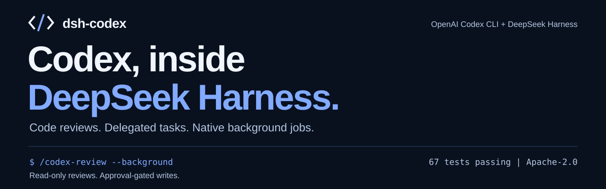
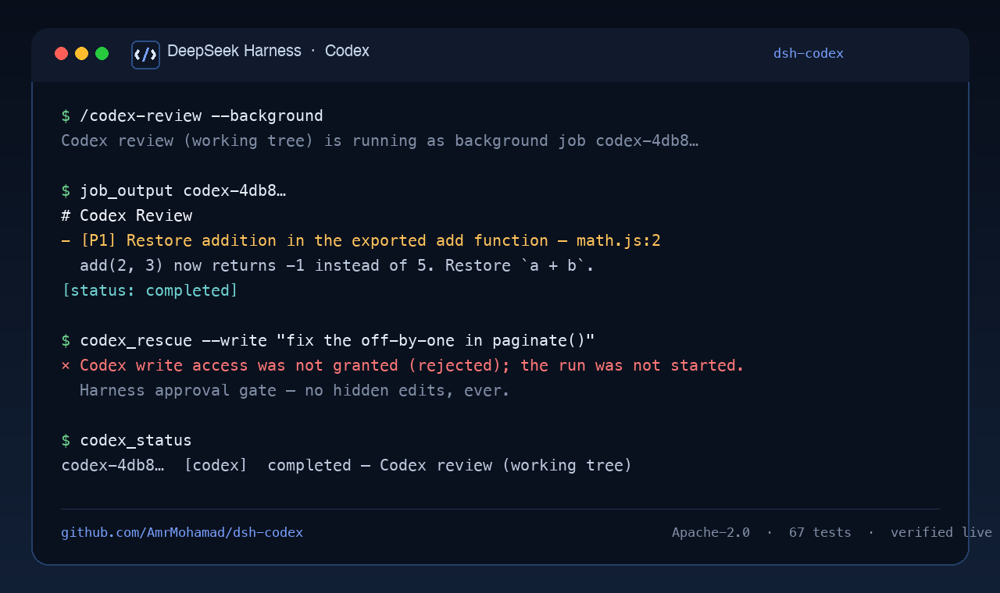

<div align="center">



<p>
  <a href="#install"></a>
  
  
  
  
  <a href="https://github.com/AmrMohamad/dsh-codex/stargazers"></a>
</p>

<h3><em>Let Codex review the code — in the Harness you already live in.</em></h3>

<p><strong>dsh-codex</strong> puts the real <strong>OpenAI Codex CLI</strong> inside <strong>DeepSeek Harness</strong>.<br/>
Native tools, real background jobs, hard safety rails. No shell wrappers, no copy-paste theatre.</p>

</div>

---

## Why this exists

OpenAI built a great Codex plugin for Claude Code. It had the right idea: let a second, independent
coding agent review your work, challenge your design, or take a task off your hands.

But "some other harness" is not where you work.

**dsh-codex is that idea, rebuilt for DeepSeek Harness.** Not a thin port of Markdown commands —
the proven app-server runtime is vendored and patched, then re-architected around DSH's native
tool registry, background-job model, approval service, prompt assembly, and skill catalog.

> **Not affiliated with OpenAI or DeepSeek.** Independent, open-source glue between two tools you
> already trust. Codex is OpenAI's; DeepSeek Harness is DeepSeek's.

## Why people star it

- **Native, not bolted on.** Six real tools, seven slash commands, a prompt section, and two embedded
  skills — everything the Harness knows how to render, approve, cancel, and resume.
- **The same Codex you trust.** It uses your local `codex` binary, your `~/.codex` auth and
  `config.toml`, your model and reasoning-effort defaults, your MCP servers, your sandbox policy.
  No new account, no second runtime.
- **Background jobs done right.** Every Codex run is a first-class DSH job: streamed output,
  `job_kill`, completion wake-ups, durable records with the Codex thread id.
- **Read-only by default.** Reviews never edit. Delegated tasks stay read-only unless you ask for
  writes — and model-initiated writes pass through Harness approval first.
- **It survives reality.** Stale brokers, crashed app-servers, cancelled turns, duplicate commands,
  symlinked credentials, token-refresh oddities: found, reproduced, fixed, regression-tested.
- **Reviewed by Codex itself.** Three independent review passes plus a delegated audit found
  **10 P1 / 26 P2** issues in this plugin. All fixed. **96 hermetic tests** guard the fixes.
  [The whole bloodbath is public.](docs/REVIEW.md)
- **Answers an agent can act on.** Every delegated task comes back as the same handoff
  report: status, evidence with `file:line`, changes or exact diffs, what was verified,
  open questions, next steps. Adversarial findings carry severity, confidence, a failure
  scenario, a fix and a test. [Prompt design.](docs/PROMPTS.md)
- **Learns from the neighbours.** Bugs reported against similar bridges (the upstream Codex
  plugin included) were checked against this code; the ones that applied are fixed and
  regression-tested. [Research notes.](docs/RESEARCH.md)

<p align="center">
  
</p>

## 60-second tour

```text
$ /codex-review --background
Codex review (working tree) is running as background job codex-4db8…

$ job_output codex-4db8…
# Codex Review
- [P1] Restore addition in the exported add function — math.js:2
  add(2, 3) now returns -1 instead of 5. Restore `a + b`.
[status: completed]

$ codex_rescue --write "fix the off-by-one in paginate()"
× Codex write access was not granted (rejected); the run was not started.

$ codex_rescue resume_last "apply the smallest safe fix"
… continues the same Codex thread, with its original context …
```

Prefer asking in plain language? Your Harness agent already knows how:

> “Ask Codex to review my current changes against main, in the background.”
>
> “Have Codex challenge this caching design before I ship it.”
>
> “Delegate the flaky integration test to Codex, read-only, and report back.”

## What you get

| Surface | Name | What it does |
| --- | --- | --- |
| Tool | `codex_review` | Codex's **native reviewer** on your working tree or a base branch. Read-only. |
| Tool | `codex_adversarial_review` | Steerable challenge review: design, tradeoffs, failure modes, hidden assumptions. |
| Tool | `codex_rescue` | Delegate investigation/fix/implementation to a persistent Codex thread. |
| Tool | `codex_status` / `codex_result` | Live and durable job records, including the Codex thread id. |
| Tool | `codex_setup` | Node/Codex/auth/app-server readiness, cached for speed. |
| Command | `/codex-review`, `/codex-adversarial-review`, `/codex-rescue`, `/codex-status`, `/codex-result`, `/codex-cancel`, `/codex-setup` | The same operations as direct human commands. |
| Skill | `codex-delegation` | When to delegate, how to write prompts Codex executes well. |
| Skill | `codex-result-handling` | Faithful reporting; never auto-apply review findings. |
| Background | native DSH jobs | Streaming, `job_output`, `job_kill`, wake-on-finish, durable results. |

## How it works

```text
DSH Host plugin (zero bare imports)
├─ index.js                  registers tools · commands · prompt section · skills
├─ lib/operations.js         review · adversarial · rescue · status · result · cancel · setup
├─ lib/jobs.js               one Codex run = one native DSH job
├─ lib/runtime.js            runner: cached node/codex resolution → spawn companion
└─ lib/…                     tools · commands · resolve · process · argv · job-store · diagnose
└─ runtime/                  vendored codex-companion (Apache-2.0, patched)
   ├─ codex-companion.mjs    CLI surface + durable job records
   ├─ app-server-broker.mjs  one shared `codex app-server` per workspace
   └─ lib/*.mjs              JSON-RPC client · review targets · prompts · state
```

A tool call starts a DSH background job → the job spawns the companion → the companion owns/joins a
per-workspace `codex app-server` broker → output streams into the job ring → the job settles with
status, durable result, and the Codex thread id. Cancellation kills the child **and** interrupts the
turn in the broker, even if the turn id had not been persisted yet.

## Safety isn't a footnote

- **Writes must be authorized.** Model-initiated `write: true` goes through `ctx.approval.request`
  (session policy applies, fails closed). Slash-command `--write` is explicit human consent.
  `writeApproval: deny | ask | allow` controls the default.
- **Read-only is the default.** Reviews cannot edit. Delegated tasks cannot edit without `write`.
- **Codex protocol requests get real answers.** Approval, elicitation, user-input, and dynamic-tool
  requests receive schema-valid refusals instead of `-32601` method-not-found. Auth-token refresh
  and attestation requests get an explicit, non-fabricated error.
- **No credential leaks through review context.** Untracked symlinks are described, never followed.
- **Cancellation is deterministic.** Broker tracks turns, interrupts orphaned sessions, and bounds
  every `turn/interrupt`.
- **The plugin does not inherit the shell sandbox.** It spawns Codex directly and says so; Codex
  runs under its own sandbox/approval policy from your `config.toml`.
- **No hidden writes.** Review output is presented, then the agent must ask which findings to fix.

## Proven, not vibes

| Claim | Evidence |
| --- | --- |
| Works against Codex 0.163 | Live runs: auth, native review, adversarial review, delegated task, resume, background + cancel. |
| Native DSH integration | Tools, commands, skills, prompt section and jobs visible in a live profile; plugin row `applied` without warnings. |
| Hardened | 10 P1 / 26 P2 review findings fixed across 5 review rounds — [docs/REVIEW.md](docs/REVIEW.md), [independent reviewer](docs/internal-review.md). |
| Tested | `npm test` → **96/96** (fake Harness context/jobs/runner, plus end-to-end runs against a fake `codex app-server`; no Codex calls). |
| Portable | Node and Codex are auto-discovered (Electron Host included), with documented overrides. |

## Install

**Requirements:** DeepSeek Harness desktop `0.2.1-rc.2+`, an installed and logged-in
`codex` CLI (`codex login`). Node is supplied by the Harness runtime; no `npm install` needed.

```bash
git clone https://github.com/AmrMohamad/dsh-codex.git
```

Then install the bundle with DeepSeek Harness's plugin manager:

```text
plugin_manager  action: install_bundle
                target: /absolute/path/to/dsh-codex/dsh-codex
```

Or via the Harness UI: **Settings → Plugins → Install bundle** and point it at the same directory.
The bundle is linked (`@local/dsh-codex`), activates live, and needs no desktop restart for a first
install.

First run:

```text
codex_setup
```

It reports Node/Codex/auth/app-server readiness and the next step. Then try a review:

```text
codex_review                       # working tree
codex_review { "base": "main" }    # branch review
/codex-review --background         # human slash command
```

### Configuration

Optional settings go on the plugin row in your profile patch (or via the environment variables):

```yaml
- id: codex
  name: '@local/dsh-codex'
  config:
    codexPath: /opt/homebrew/bin/codex   # default: auto-detect PATH + common locations
    nodePath: /path/to/node              # default: Harness runtime / bundled node / PATH
    dataDir: ~/.dsh/codex-plugin-data    # default: $DSH_HOME/codex-plugin-data
    writeApproval: ask                   # ask (default) | allow | deny
```

Environment equivalents: `CODEX_PLUGIN_CODEX_PATH`, `CODEX_PLUGIN_NODE`,
`CODEX_PLUGIN_DATA_DIR`. Precedence: plugin config → documented env → discovery. `~` is expanded.
Model/effort defaults come from your Codex `config.toml`; tools can override per run.

## FAQ

<details>
<summary><strong>Does this use a separate Codex account or runtime?</strong></summary>

No. Same local CLI, same `~/.codex` authentication, same `config.toml`, same machine and working
tree as running `codex` yourself.
</details>

<details>
<summary><strong>Will my Harness agent auto-fix review findings?</strong></summary>

No. The prompt section and `codex-result-handling` skill require it to present findings and ask
before changing anything. Reviews are read-only at the protocol level.
</details>

<details>
<summary><strong>Why did my write run get refused?</strong></summary>

Model-initiated writes need Harness approval. If your session approval policy is `never`, the gate
fails closed. Preauthorize with `writeApproval: allow` (deliberate) or run `/codex-rescue --write`
as a human. Commands treat `--write` as explicit consent.
</details>

<details>
<summary><strong>Does it work on Windows?</strong></summary>

macOS is verified end-to-end. Windows-specific paths (tree-kill, pipes) are implemented and
unit-tested but not executed on a real Windows host yet. PRs with Windows logs are very welcome.
</details>

<details>
<summary><strong>How is this different from just running `codex` in a terminal?</strong></summary>

A terminal Codex is unaware of your Harness session. dsh-codex turns Codex work into native tools
and jobs: the agent can start a review, keep working, get woken on completion, read durable results,
resume the same Codex thread, and cancel safely.
</details>

## Roadmap

- [ ] Broker replacement using Codex's native `app-server --listen unix://`
- [ ] Optional per-approval bridge into DSH (individual Codex escalations)
- [ ] Web UI panel for Codex jobs/threads
- [ ] DSH-session transfer into a Codex thread
- [ ] Windows end-to-end verification and CI matrix
- [ ] More models/providers surfaced in `codex_setup`

## Contributing

Issues and PRs are welcome — especially Windows logs, adapter ideas, and prompt-contract
improvements. Keep changes small, add a regression test, and run:

```bash
cd dsh-codex && npm test
```

See [CONTRIBUTING.md](CONTRIBUTING.md) for the dev loop and review expectations, and
[AGENTS.md](AGENTS.md) for the module map and invariants (written for humans and coding agents).

## License & attribution

Apache-2.0. The vendored runtime is derived from
[openai/codex-plugin-cc](https://github.com/openai/codex-plugin-cc) (Apache-2.0); see
[LICENSE](LICENSE), [NOTICE](NOTICE), and `dsh-codex/runtime/NOTICE`.

This is an independent community project. It is **not** endorsed by, affiliated with, or maintained
by OpenAI or DeepSeek. "OpenAI", "Codex", and "DeepSeek Harness" are used only to describe
compatibility.

---

<div align="center">

**If dsh-codex saves you a review cycle, a ⭐ helps the next Harness user find it.**

<a href="https://github.com/AmrMohamad/dsh-codex">github.com/AmrMohamad/dsh-codex</a>

</div>
